# Xenite Frontier

*Horde tower defence. Contracted colonists hold remote mining outposts against
a starving, predatory alien swarm.*

Engine: **Godot 4.4** (GDScript, Forward+). All art is original and generated
procedurally at runtime (no imported assets). There is a drop-in hook for your
own `.glb` models, described in `art/README.md`.

---

## How a run plays (M5a)
1. **Choose your landing site.** Click open, flat ground away from the canyon
   mouths. A green 7x7 footprint means valid. The Command Hab lands there, the
   pad is levelled, and you start with 450 Biomass, 6 workers and 4 soldiers.
   Glowing teal **Xenite deposits** around the map are where Mining Rigs go.
2. **Build phase.** A countdown runs (90 s before wave 1, then 40 s). Press
   **N** or the button to **call the wave early** for +3 Biomass per second left.
3. **Wave.** The swarm arrives in packs from random canyon mouths, spread over
   about 28 s. Wave sizes are **30% smaller** than the base schedule
   (`waves.json size_multiplier: 0.7`). Every wave grows and toughens a little,
   and Threat Level rises by +0.25 per wave.
4. **Payday** after every wave survived:
   * **Company bounty:** (60 + 12 x wave) x Threat Level.
   * **Xenite ore sale:** mined Xenite x 3 Biomass. A 25% contract share is
     banked toward the Colony Charter (M6).
   * **Wages:** 3 per worker and 5 per soldier. Can't pay? Morale drops and
     crews and soldiers fire 20% slower until you can.

### Workers and soldiers
* **Workers** (white EVA, yellow visor, tool pack) **build** every structure,
  since construction is no longer instant: sites show scaffolding and progress.
  They also **repair** damage automatically (paying Biomass per HP), **staff**
  economy buildings and Mining Rigs, and crew spare turrets.
* **Soldiers** (grey armour, red shoulder band, mirrored visor, rifle) crew
  turrets first, then **garrison Guard Posts** and shoot from them (+4 m range).
  * **Squad orders:** click a soldier or drag a box around several, then
    **right-click** to send them anywhere. They hold there and shoot.
  * **H** returns them to automatic duty.
* **Recruit** workers at the Command Hab (click it, 40 Biomass) and train
  soldiers at a Barracks (60). Population cap is 12 plus 4 per Hab Module.

### Colony buildings (COLONY tab)
| Building | Effect |
|---|---|
| Harvester Bay | drones collect corpse Biomass |
| Mining Rig | on a Xenite deposit; a worker mines 14 Xenite/min, sold after each wave |
| Hab Module | +4 population |
| Barracks | train soldiers |
| Bio-Refinery | +25% Biomass from drone deliveries (max 2 count) |
| Fabricator | -15% build and upgrade costs (max 2 count) |
| Armory | unlocks tier III turret upgrades, +25% soldier damage |
| Medbay | wounded recover twice as fast; soldiers heal on base |
| Guard Post (DEFENCE tab) | 2 soldiers garrison it |

Buildings marked "needs 1 worker" only work while staffed.

### A more realistic horde
* Stride phase advances with the **distance actually walked**, so feet never
  slide.
* **Packs** leave one canyon mouth together and hold a shared lane.
* Aliens out in the open **pause to sniff** before pressing on.
* Wider size (±12%) and speed (±22%) variation.

## Art direction
* **Aliens:** built from your concept sheet *"predatory/primal – Humanoid
  Lineup v3"* (`docs/concept_humanoid_lineup_v3.svg`). They are gaunt,
  faceted (flat-shaded) bipeds in charcoal (#1c1c1a / #2b2c29) with a light
  olive front panel (#8f8a52), bone-white claws and teeth (#e8e4d6), and one
  glowing identity colour each.
  | Strain | Look | Identity |
  |---|---|---|
  | Stalker | hunched, long jaw, black back spikes, long arms; Brood young are *runts* | white eye #e8e4d6 |
  | Mauler | gorilla build, boulder shoulders and head, huge rock fists it knuckle-walks on, white fang | red #c8201f eyes and slashes |
  | Spitter | upright, black back spikes, glowing throat sac; hunches forward to spit | green #3fd23a |
  | Snatcher | very long arms dragging white claws, yellow back spines | yellow #e3c21b |
  | Burrower | legless segmented torso, circular orange-toothed maw; while tunnelling only the head and a moving dirt mound break the surface | orange #e8871a |
  | Brood Mother | tall, faceted purple egg sac on her back with glowing spots, crown of white spikes | magenta #d42bb4 |

  A GPU biped rig (hip, knee, shoulder, elbow, neck pivots stored per vertex)
  walks them upright. Fast strains drop to all fours to sprint. They crouch to
  feed, rear up to attack, and Spitters hunch forward to spit.
  Corpses follow the brief:
  * Stalker: curls up on its side and splits along the back.
  * Mauler: face-first; its boulders crack off and scatter.
  * Spitter: its sac bursts into an acid pool.
  * Snatcher: on its back, arms up.
  * Burrower: face-first, segments drifting apart.
  * Brood Mother: face-first, sac ruptured, dead young spilled, huge ichor pool.
* **Ichor** is acid green; **human blood** dark red.
* **Humans and buildings** are industrial: off-white, hazard yellow, worn grey.
  **Dragged colonists flail and kick.**
* **Turrets** carry their damage-type accent stripe and matching muzzle
  effects: Ballistic orange, Incendiary red, Piercing cyan, Shock electric
  blue, Explosive yellow, Seismic brown. Tiers II/III add armour plating and
  +10% size per tier.
* **The planet:** rust-orange rock under a dim violet sky with a large ringed
  gas giant and a small moon. Zoom in and the camera tilts toward the horizon
  to show them.

## Current milestone: **M4 – colonists, abduction, feeding**

M4 adds the people you are defending, and the swarm's hunger.

### Colonists crew your turrets
* You start with **10 contracted colonists** sheltering in the core.
  `data/colonists.json` has the crew size, walk speed and rates.
* Each turret needs one crew. Colonists walk out to the most valuable uncrewed
  turrets automatically. **Uncrewed turrets fire at 40%.** Tier upgrades raise
  *crew efficiency* (115% / 130% fire rate while crewed).
* Colonists path around walls with A*. **Blast Doors let colonists through
  but not aliens.** A turret walled off without a door can't be crewed.
* The top bar shows crew status. The event feed (left) reports every
  abduction, rescue and loss. The Inspector shows a turret's crew, or
  "UNCREWED – firing at 40%".

### Abduction: kill the carrier
* Anyone outside the core is **exposed**: walking to a post, bailing out of a
  destroyed turret, or limping home.
* **Snatchers and Burrowers** grab exposed colonists and **drag them
  toward the nearest canyon mouth** at 70% speed, leaving a blood trail.
  **Snatchers hunt**: they sense colonists within 14 m (their own flow field)
  and even **rip crews out of turrets**.
* Turrets **prioritise carriers.** Kill the carrier and the colonist drops,
  wounded. They limp back to the core and recover for 40 s before returning to
  duty. Colony Charter medics will shorten this in M6. If the carrier reaches
  the map edge, the colonist is gone, and that turret loses its crew for good.
* **Maulers and Brood Mothers** don't carry. They maul exposed colonists to
  death, leaving remains.

### Feeding: the swarm grows
* Aliens standing on corpses stop to eat (per-strain `feed_rate` in
  `aliens.json`; Brood Mothers gorge). Each meal grows the alien
  **×1.12 in size** (up to ×1.9) and adds 35% of its base HP.
* **Human remains are worth 3 meals**, and aliens eat them first.
* Eaten corpses yield no Biomass. Eating also lowers corpse piles. Grown
  aliens leave bigger corpses worth more Biomass (×size).
* Harvester drones and feeding aliens compete for the same corpses. Place
  bays so drones get there first.

## The economy (M3)

M3 added the in-run economy. Every build, upgrade and repair costs
**Biomass**, and Biomass only comes from alien corpses, carried home by
**harvester drones** from a **Harvester Bay**. The swarm ramps up over the
first 90 s, so spend fast.

### The Biomass loop
1. Turrets kill aliens. Each corpse holds Biomass (Stalker 2, Spitter 3,
   Snatcher 4, Burrower 6, Mauler 14, Brood Mother 80).
2. **Charred corpses hold nothing.** Anything killed by Incendiary damage,
   including burning to death, is burned. Flamethrowers are strong but cost
   you income.
3. Each Harvester Bay launches drones (2/3/4 by tier) that collect corpses
   inside its range (16/19/22 m). A drone strips a corpse, keeps collecting
   until it carries 24 Biomass, then flies home and deposits it. A "+N" pops
   up over the bay.
4. **Harvesting removes the corpse**, which also lowers its pile. A bay near
   your walls stops the swarm piling up and climbing over.
5. Corpses outside every bay's range eventually decay (corpse cap) and that
   Biomass is lost. The debug panel shows "lost to decay".

### Spending
| | Cost |
|---|---|
| Wall / Blast Door / Floodlight | 8 / 30 / 35 |
| Harvester Bay | 120 (tiers II/III: 140/240) |
| Autocannon / Flamethrower / Railgun | 60 / 70 / 120 |
| Shock Grid / Mortar / Seismic Spike | 90 / 110 / 85 |
| Turret tier II / III | 80–150 / 150–280 by turret |
| Sell | refunds 50% of everything invested |
| Repair | 0.04 Biomass per missing HP |

**Turret tiers.** Each turret has 3 linear tiers bought in-run. They raise
damage (×1.45 / ×2.0), range (×1.12 / ×1.25), crew efficiency, which is fire
rate while crewed (115% / 130%), and HP. Tier pips light up on the base. At
tier III the Inspector notes that specialisations unlock in the Colony
Charter (M6).

**Floodlights** light a radius of 11 m. At night (M5) turrets can only see
lit targets. Build them now so you're ready.

**Every economy number is in `data/economy.json`**, including the values
later milestones use: night bonus, early-call bonus, Xenite payouts, Threat
Level and Hazard Contracts. Balance there without touching code.

### Running

1. Install Godot **4.4.x** (standard build, not .NET).
2. **After cloning or pulling:** import once so Godot builds its script class
   cache (`.godot/`, not in git). Opening the project in the editor also does it.

```bash
godot --headless --path xenite_frontier --import
```

3. Run the game:

```bash
godot --path xenite_frontier
```

On Windows, `run_benchmark.bat` does the import and runs the benchmark:

```bash
xenite_frontier\run_benchmark.bat "C:\path\to\Godot_v4.4.1-stable_win64_console.exe"
```

### Controls (M5a)

| Action | Keyboard / mouse | Gamepad |
|---|---|---|
| Build category (Defence / Turrets / Colony) | Tab | – |
| Pick build tool | 1-8 within the category | LB / RB |
| Build (drag to paint walls/doors) | Left click | A (at screen-centre crosshair) |
| Select a structure / the Command Hab (no tool) | Left click | A |
| Select soldiers | Click one, Shift-click to add, or drag a box | A on a soldier |
| Order selected soldiers | Right click on the ground | B |
| Return soldiers to their posts | H | – |
| Call the next wave early | N | D-pad left |
| Upgrade selected | U or Inspector button | X |
| Repair selected | R or Inspector button | Y |
| Sell (50% refund) | Right click (drag with a tool) | B |
| Deselect | Esc / right click elsewhere | – |
| Intel: counter table | I | D-pad right |
| Sandbox pressure (`--sandbox` only) | + / −, F5–F8 | D-pad up / down |
| Pan camera | WASD / arrows / screen edge / middle-drag | Left stick |
| Fast pan | Shift | L3 |
| Zoom | Mouse wheel / Q, E | LT / RT |
| Pause simulation | Space | Start |
| New run (back to landing) | F10 | – |
| Sandbox free build | F11 | – |
| Run benchmark | B / F9 | – |
| Flow-field heatmap | F | – |
| Gore on/off | G | – |
| Detailed HUD + help | F1 | Back |

Selecting a structure opens the **Inspector** (bottom right). It shows HP,
current and next-tier stats, kills, and the bay's drones and range, with
Upgrade / Repair / Sell buttons and their costs. Range rings show for the
selected or hovered turret, bay or floodlight.

### Damage types and counters

Weak = 150% damage, resists = 50%. This lives in `data/aliens.json` and is
shown in game in the build card and the Intel panel (**I**).

| Strain | Trait | Weak to | Resists |
|---|---|---|---|
| Stalker | fast swarm, low HP | Incendiary, Shock | Piercing |
| Mauler | armoured; x4 damage to blast doors | Piercing | Ballistic |
| Spitter | stops at range and lobs acid at structures | Explosive | Shock |
| Snatcher | fast; dodges 35% of aimed shots | Shock, Ballistic | Explosive |
| Burrower | tunnels under walls; only Seismic reaches it underground | Seismic | Incendiary |
| Brood Mother | boss; births Stalker broods | Piercing, Explosive | Shock |

| Turret | Type | Behaviour |
|---|---|---|
| Autocannon | Ballistic | rapid aimed shots (dodgeable) |
| Flamethrower | Incendiary | cone that sets aliens burning; incendiary kills leave charred corpses |
| Railgun | Piercing | long-range slug through up to 5 aliens in a line |
| Shock Grid | Shock | arcs into up to 14 nearby aliens and slows them |
| Mortar | Explosive | lobbed splash shells, 6 m minimum range, out-ranges Spitters |
| Seismic Spike | Seismic | ground slam that hits tunnelling Burrowers and forces them up |

### How the swarm fights structures
* **The flow field paths *through* structures at a cost.** A wall costs 24
  metres of detour. If the way around is longer, the field leads into the wall
  and aliens bash it. Seal the outpost completely and they pick the cheapest
  wall and pile in.
* **Corpses pile up physically.** Each corpse adds height to its cell
  (Stalker 0.14 m up to Brood Mother 1.2 m) and rests on top of the pile.
  When a pile beside a wall reaches **1.6 m**, the wall becomes climbable.
  It tints green, its path cost drops, and the swarm streams over the top.
  Clear kill zones away from your walls.
* **Spitters** stop up to 9 m short and shell structures with acid.
  **Burrowers** follow a second flow field where only rock blocks, and surface
  8 m from the core or when a Seismic Spike slams them.
  **Brood Mothers** spawn 4 Stalkers every 7 s.
* Losing the core = **OUTPOST OVERRUN**. Press **R** to rebuild.

### Swarm pressure (sandbox)
Until waves arrive in M5, the sandbox spawns aliens at a **rate**. The default is 240
per minute (`swarm.spawn_per_minute`), ramping up over the first 90 s, with at
most 20,000 alive. Killing fast genuinely thins the swarm. In headless 3-minute
tests, a sensible layout holds 240/min with every colonist alive, an idle
outpost falls, and 480/min breaks a decent defence.

### Stuck-alien diagnostics
```bash
godot --headless --path xenite_frontier -- --bot --combat-test=180 --stuck-report
```
This lists aliens that have not moved for 4 s without a reason (eating, bashing,
shelling and gnawing don't count). It groups them by cell, gives the likely cause,
and draws an ASCII map of each spot. A safety net also runs once a second
in game: an alien stuck over 6 s inside rock, or somewhere with no path, is moved
to the nearest reachable cell.

### Benchmark

Press **B** in game. The run ramps to 10,000 aliens over 6 s, settles for 2 s,
then records 20 s. During the run the core is invulnerable, aliens that reach
it are recycled, and turrets keep fighting, so the figures include combat.
VSync and the FPS cap are switched off while it records. The report is
appended to `user://benchmark.log`.
On Windows that is `%APPDATA%\Godot\app_userdata\Xenite Frontier\benchmark.log`.

```bash
godot --path xenite_frontier -- --benchmark
```

```bash
godot --path xenite_frontier -- --benchmark=20000
```

Exit code 0 = pass, 2 = 1% low below 60 fps. Add `--headless` to measure the
simulation alone, without rendering.

Headless soak (prints kills by strain and turret, damage share, core HP and the Biomass flow). `--bot` adds a scripted player that builds, upgrades and repairs:

```bash
godot --headless --path xenite_frontier -- --bot --combat-test=180
```

---

## Architecture

```
xenite_frontier/
  project.godot
  data/
    aliens.json        strain stats, traits, counters (weak/resists), spawn weights
    turrets.json       damage types, counter multipliers, turret stats
    structures.json    walls, blast doors, core HP, climb height
    colonists.json     crew size, walk speed, uncrewed rate, recovery, carrier speed, names
    waves.json         wave schedule (size x0.7), timers, packs, growth
    economy.json       ALL economy values: Biomass, costs, upgrades, drones, Xenite, Threat, Hazard Contracts
    game_config.json   benchmark / swarm / combat caps / map tuning
  scenes/main.tscn     root; everything else is built in code
  scripts/
    core/game_config.gd   autoload: loads all data files
    core/input_setup.gd   default key/mouse/pad bindings (rebindable later)
    sim/flow_field.gd     cost-based Dijkstra flow field (surface + burrow), async rebuild
    sim/alien_pool.gd     struct-of-arrays storage per strain + MultiMesh
    sim/swarm.gd          threaded per-chunk swarm step incl. strain traits
    sim/combat.gd         spatial grid, damage/counters, projectiles, deaths
    turrets/turret.gd     six turret behaviours
    turrets/turret_models.gd  primitive turret models
    world/structures.gd   walls/doors/turrets: HP, placement, destruction
    world/corpses.gd      pooled corpses + pile heights + Biomass value
    econ/economy.gd       Biomass wallet, costs, refunds, deposits
    econ/harvester.gd     Harvester Bays + drone state machine
    colony/colonists.gd   workers & soldiers: jobs, A* walking, recruitment, squads, abduction, rescue
    game/wave_director.gd landing -> build countdown -> waves -> payday (bounty, ore, wages)
    render/alien_meshes.gd   grey alien family (near/far LOD), joint rig data
    render/alien.gdshader    GPU joint animation: walk / all-fours sprint / feed / attack
    render/mesh_acc.gd       primitive-to-mesh builder (vertex colours, part ids)
    render/station_models.gd hab dome, barrier walls, doors, props, crystals, boulders
    render/terrain.gdshader  planet surface (regolith, strata cliffs, craters, build grid)
    render/sky.gdshader      dim violet sky, ringed gas giant, small moon
    render/fx.gd / fx.gdshader  pooled particles, beams, ichor splats
    render/ground.gdshader
    world/outpost_map.gd  grid (ground/rock/wall), spawn zones, core, visuals
    camera/rts_camera.gd  angled top-down camera
    ui/hud.gd, build_bar.gd, ui_style.gd   HUD, build bar, Intel panel
    ui/benchmark_runner.gd  scripted benchmark
```

### How 10k aliens stay cheap
* **No per-unit pathfinding.** One flow field covers the whole map. It is an
  8-connected Dijkstra pass from the outpost core using an O(cells) bucket queue,
  then one direction per cell. Each alien reads its cell. A rebuild costs the
  same at 10 aliens or 100,000.
* **Struct-of-arrays pools** (`PackedFloat32Array`) per strain, dense with
  swap-remove. No nodes, no objects, no allocations per alien.
* **Crowd separation without neighbour queries.** Aliens splat their mass
  into a 0.5 m density grid. Next frame each alien is pushed down the density
  gradient, plus a spread within its cell. This is O(1) per alien and produces
  the piling, pressing horde look.
* **Threaded.** Each frame the swarm is cut into 1,024-alien chunks that run on
  `WorkerThreadPool`.
* **One upload per strain.** The simulation writes transforms straight into the
  MultiMesh buffer, which goes to the GPU with a single `multimesh_set_buffer`
  call. That gives 6 draw calls for the whole swarm.
* **Animation on the GPU.** Gait swing and bob happen in the vertex shader,
  phased by `INSTANCE_ID`.

### Using your own models
Each strain in `data/aliens.json` accepts `"mesh": "res://art/<name>.glb"` to
replace its procedural model. `art/README.md` lists the requirements:
orientation, triangle budget, vertex colours and part ids for the animation rig.

---

## Roadmap
- [x] **M1** 10k aliens via flow field, perf benchmark
- [x] **M2** Walls, turrets, damage types and counter table, death, corpse piling
- [x] **M3** Biomass economy, harvester drones, in-run turret tiers
- [x] **M4** Colonists, abduction, feeding
- [~] **M5** Build/battle phases (M5a done: phases, waves, timer, Threat Level, workers/soldiers, finance; M5b: day/night, abilities), waves, day/night, abilities, Threat Level
- [ ] **M6** Xenite, Colony Charter, specialisations, Hazard Contracts, save/load
- [ ] **M7** Gore/juice pass, 3 outposts, balance pass
- [ ] **M8** Steam (GodotSteam), achievements, cloud saves, Deck/controller, export + upload scripts

See `CHANGELOG.md` for per-milestone notes.

## Screenshots (software-rendered)

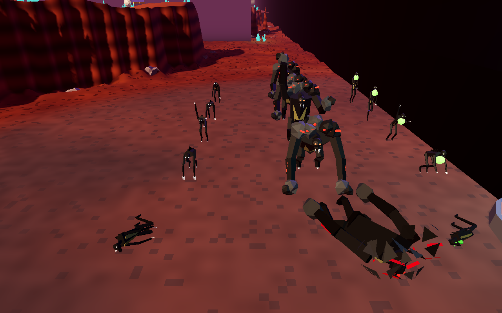
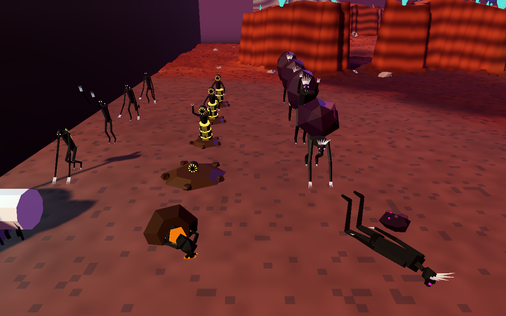

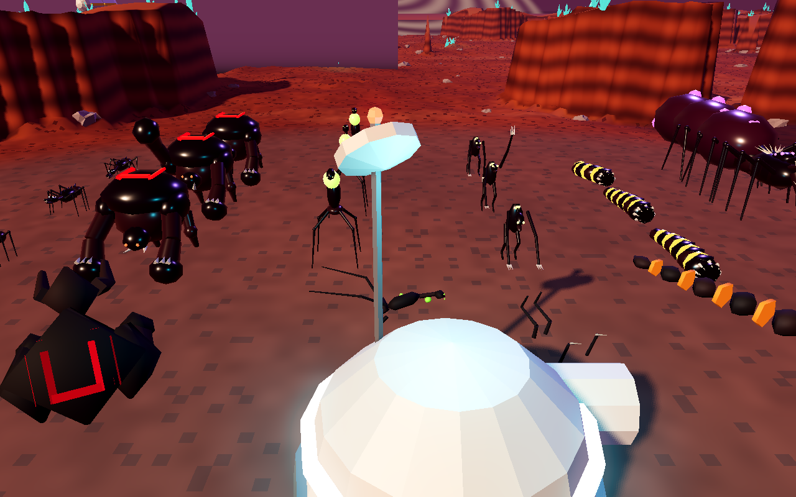
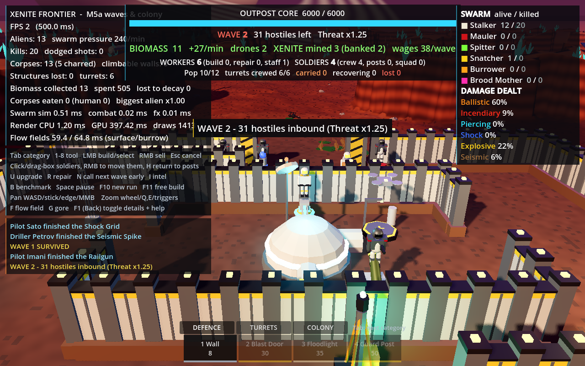

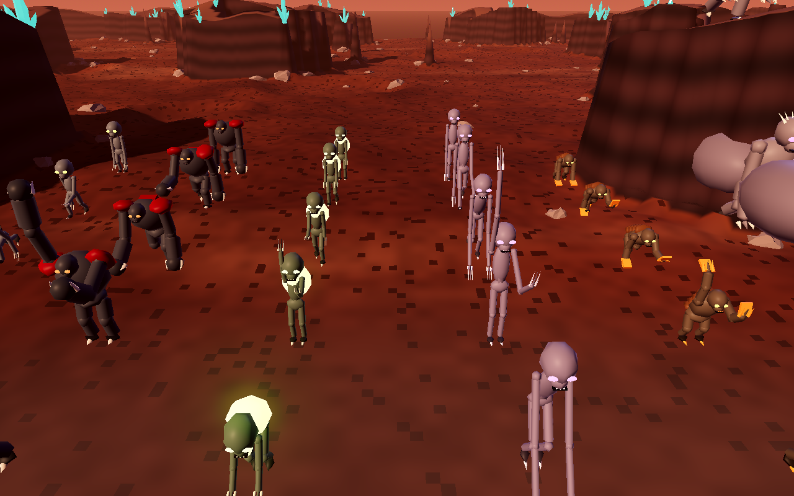
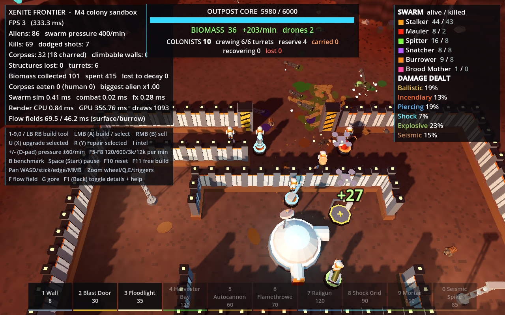

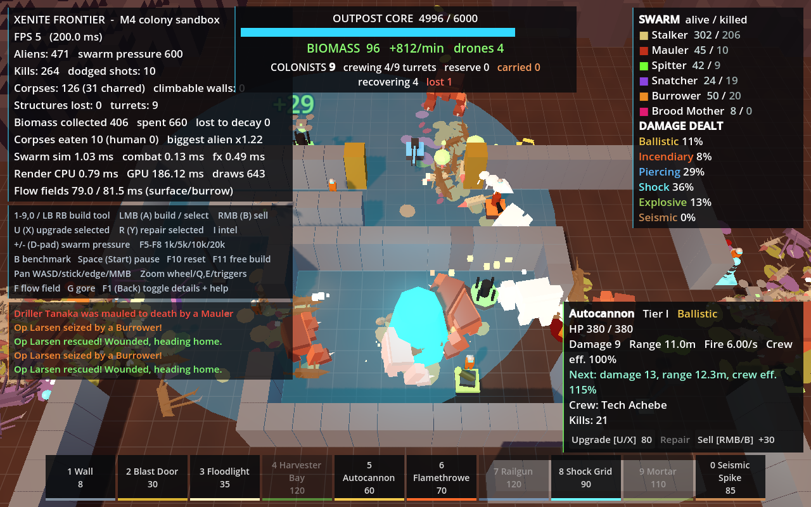

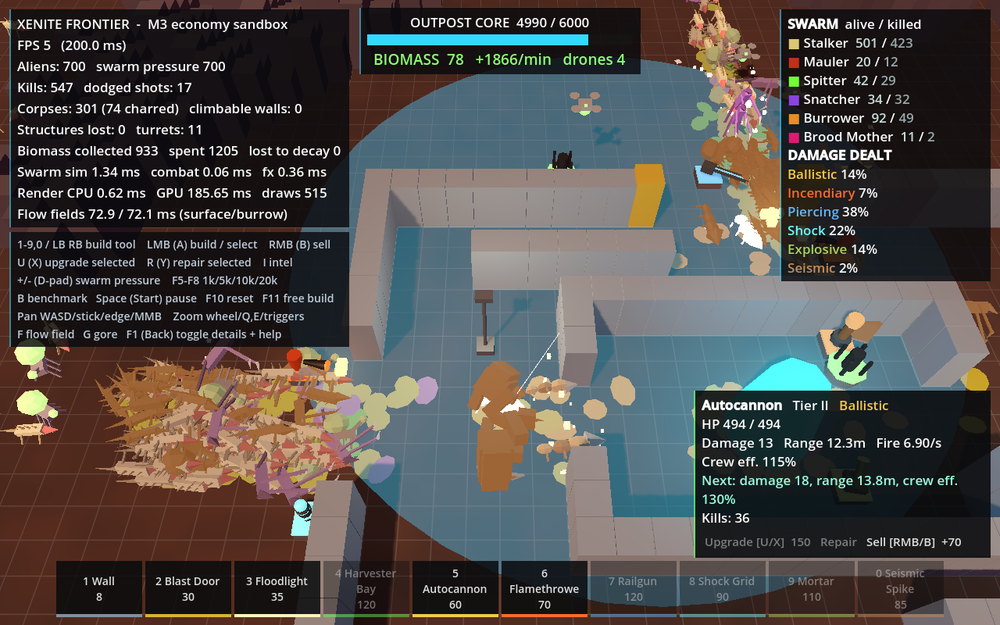

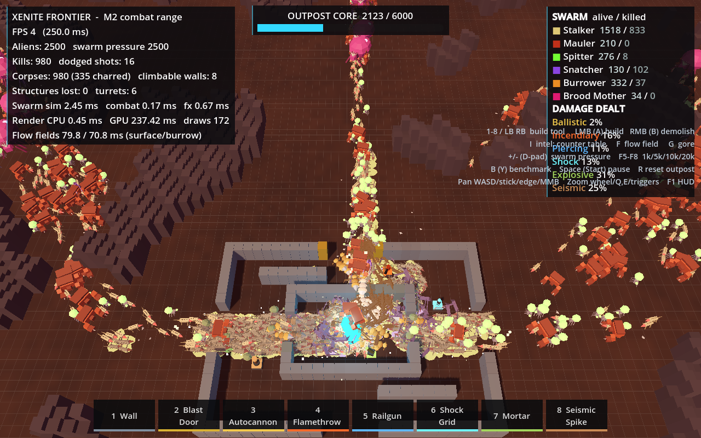
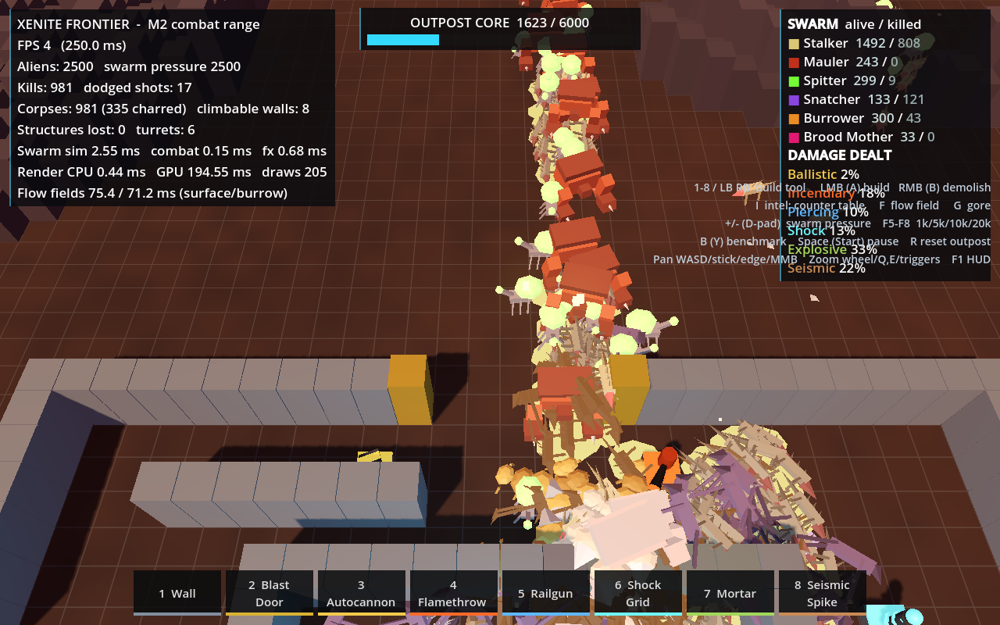
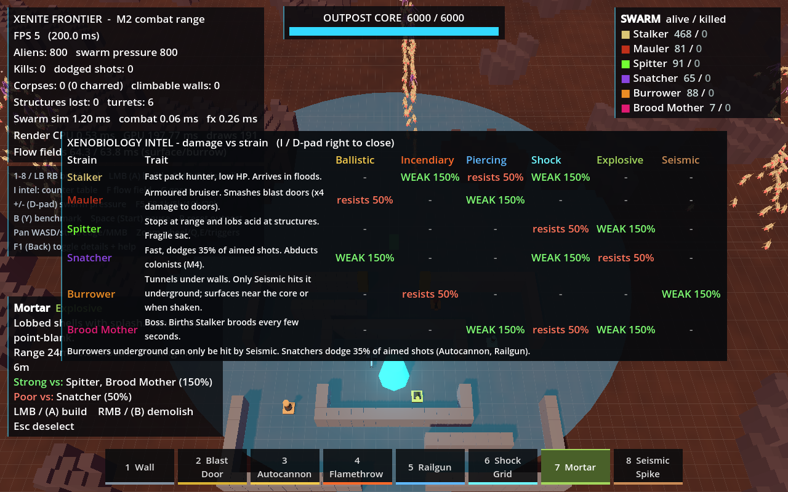

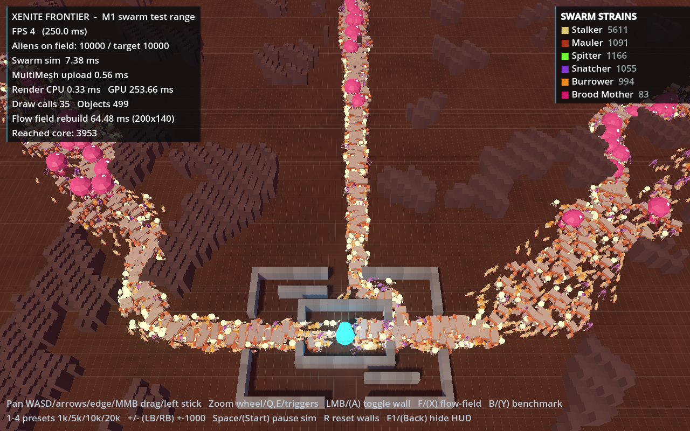
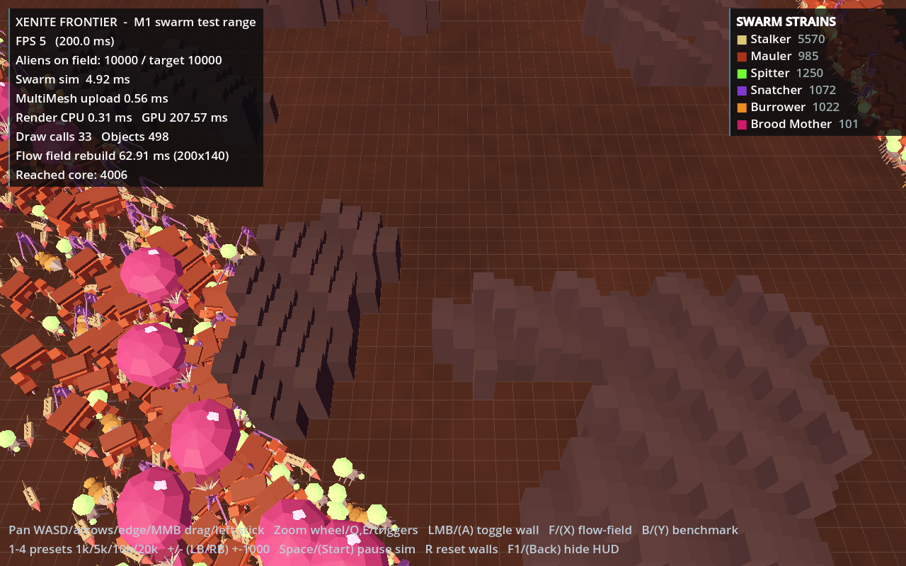
